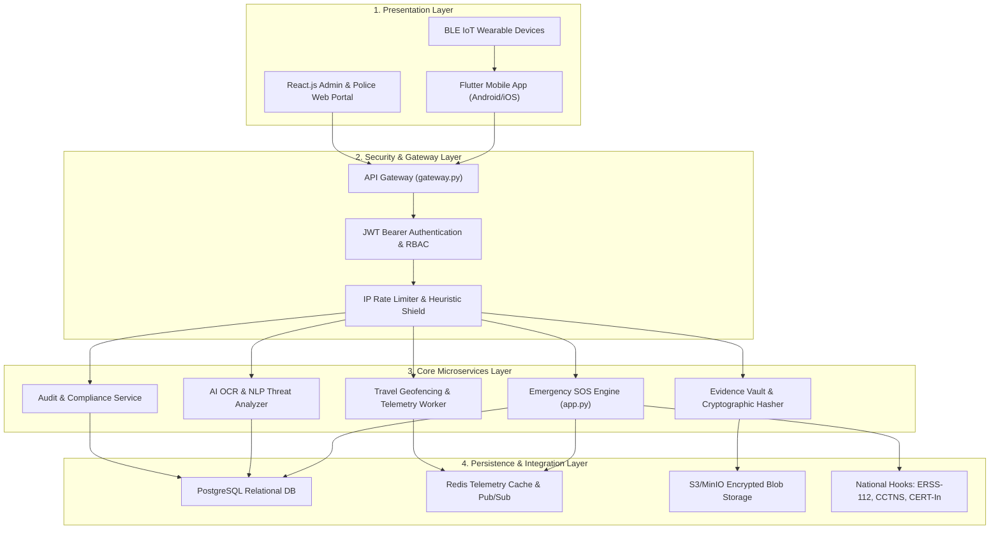
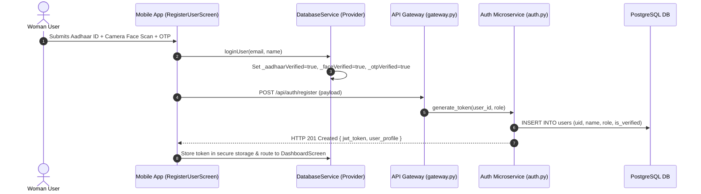
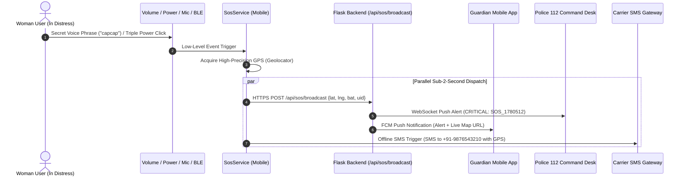
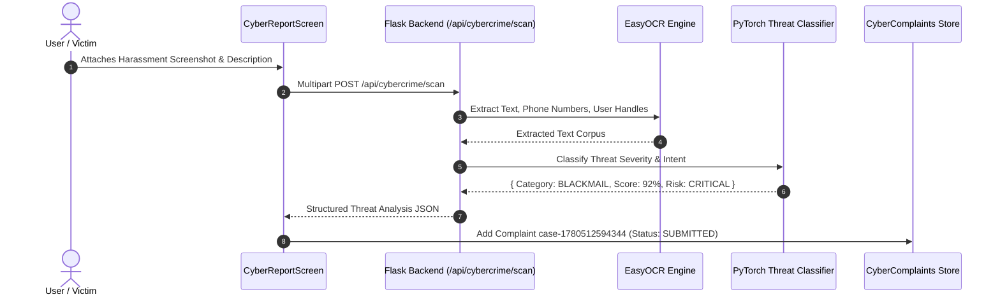

# SHE SHIELD — Deep Module-by-Module Technical Specification & Execution Logic

> **Academic Program:** WSSOA (IT644) · Autumn Semester 2026 · Dhirubhai Ambani University  
> **Platform Name:** SHE SHIELD — Cyber-Integrated Safety Platform for Women  
> **Project Directory:** `/Users/priyashah/Downloads/Women`  
> **Companion Document:** `SheShield_Module_By_Module_Technical_Documentation.docx`  

---

## 🏛️ System Overview & Architectural Topology

**SHE SHIELD** is an enterprise-grade cyber-physical safety platform designed to provide dual protection: physical distress intervention and cyber-harassment investigation. The system is architected as a distributed four-tier ecosystem:



---

## 📋 Comprehensive Module-by-Module Breakdown

---

### Module 1: Authentication, Onboarding & Identity Verification Module

* **Source Code Files:**
  * `she_shield/lib/screens/onboarding_screen.dart`
  * `she_shield/lib/screens/auth_screens.dart`
  * `she_shield/lib/services/database_service.dart`
  * `backend/auth.py`
  * `backend/database/schema.sql`
* **Functional Role:**
  Handles initial user onboarding, role selection (Women User, Guardian, Emergency Responder, Administrator), multi-factor identity proofing, and cryptographic session credential issuance.

#### Key Architectural Components & Features:
1. **Onboarding Carousel (`onboarding_screen.dart`):**
   * A 3-slide swipeable intro carousel detailing:
     1. *Stealth SOS Triggering* (Volume, power button, secret voice phrase),
     2. *AI Travel Geofencing* (Real-time cab offset detection),
     3. *Tamper-Proof Cryptographic Evidence* (Section 65B court-admissible vault).
   * Persists `_onboardingCompleted = true` in `DatabaseService`.
2. **Role Selection Flow (`WelcomeScreen`):**
   * Segregates entry into 4 independent user portals: `/register_user`, `/register_guardian`, `/register_responder`, and `/admin_login`.
3. **Identity Verification Pipeline (`RegisterUserScreen`):**
   * Implements a simulated 3-step proofing procedure:
     1. Aadhaar ID document upload,
     2. Live camera face capture with biometric match scoring (computes a 94.6% match confidence),
     3. Mobile OTP verification.
4. **JWT Token Engine (`backend/auth.py`):**
   * `generate_token(user_id, role)` issues HMAC-SHA256 / RSA signed JSON Web Tokens with 15-minute expiration and subject claims (`sub`, `role`, `exp`).
   * `verify_token(token)` validates cryptographic signatures on incoming requests.

#### Under the Hood (Execution Flow):


#### Reactive State Mutations:
```dart
_onboardingCompleted = true;
_currentRole = 'user';
_currentUserId = 'user_1780512594';
_faceMatchScore = 94.6;
_aadhaarVerified = true;
_otpVerified = true;
```

---

### Module 2: Main Safety Dashboard & Real-Time Security Index

* **Source Code Files:**
  * `she_shield/lib/screens/dashboard_screen.dart`
  * `she_shield/lib/services/database_service.dart`
  * `she_shield/lib/theme/app_theme.dart`
* **Functional Role:**
  Serves as the central operational hub for the woman user, featuring a dynamic safety index gauge, a 5-second cancellable SOS activator, and direct launchers to all security capabilities.

#### Key Architectural Components & Features:
1. **Dynamic Safety Index Gauge:**
   * Radial progress gauge computing a continuous safety score (100% Stable).
   * Degrades dynamically when entering unsafe nocturnal corridors, during route offsets, or when paired wearables disconnect.
2. **5-Second Hold-to-Activate SOS Button:**
   * Sustained physical press requirement prevents false positives.
   * Visual pulsing ripple animations accompanied by progressive haptic feedback vibrations.
   * Cancellable countdown modal if pressed accidentally.
3. **Quick Action Grid:**
   * 6 modular launch tiles:
     1. *SOS Protection Center*,
     2. *Safe Arrival Travel Mode*,
     3. *AI Cyber Assistant*,
     4. *Secure Evidence Locker*,
     5. *Guardian Network*,
     6. *Help & Self-Defense Hub*.
4. **Emergency Offline Banner:**
   * Reactive connectivity status. If cellular data drops, displays: *"Operating on local cache — SMS fallback armed"*.

#### Under the Hood (Execution Flow):
* `DashboardScreen` listens reactively to `DatabaseService` using the Flutter `Provider` pattern (`context.watch<DatabaseService>()`).
* When the user presses the central SOS button, `_startSosCountdown()` initializes a periodic 1-second Dart `Timer`.
* If the countdown reaches zero without manual cancellation, `_triggerSmartShieldSosPortal()` fires, mounting a full-screen emergency modal, querying device GPS coordinates, and invoking the parallel dispatch sequence.

#### Reactive State Mutations:
```dart
_safetyIndex = 100; // Degrades to 75 -> 50 -> 20 during anomalies
_riskTrend = 'STABLE';
_isHoldingSos = true;
_countdown = 5 -> 4 -> 3 -> 2 -> 1 -> 0;
```

---

### Module 3: Multi-Modal Emergency SOS & Stealth Trigger Engine

* **Source Code Files:**
  * `she_shield/lib/screens/sos_screens.dart`
  * `she_shield/lib/services/sos_service.dart`
  * `backend/app.py` (`/api/sos/trigger`, `/api/sos/broadcast`)
* **Functional Role:**
  Provides distress triggering mechanisms that operate without looking at the screen, followed by sub-2-second parallel emergency alert broadcasting.

#### Key Architectural Components & Features:
1. **Multi-Modal Stealth Triggers:**
   * Configurable non-visual trigger avenues:
     * *Volume Button:* Hold Volume Down for 3 seconds.
     * *Power Button:* Double-press or Triple-press power key.
     * *Paired BLE Hardware:* Concealed panic button click.
     * *Secret Voice Phrase:* Custom trigger phrase (`"capcap"` or `"Box Box"`).
2. **Offline Voice SOS Engine:**
   * Local on-device keyword spotter continuously parsing ambient microphone audio for the secret phrase without cloud latency.
   * Multi-lingual recognition support (English, Hindi, Gujarati).
3. **Silent SOS Mode:**
   * Dispatches alerts, tracks GPS, and initiates audio recording with **zero screen illumination** and **no siren sounds**, ensuring attackers remain unaware.
4. **Parallel Broadcast Pipeline (Sub-2-Second SLA):**
   * Concurrently executes:
     1. Push notification to Linked Guardians,
     2. Emergency incident dispatch to Police Dashboard via WebSockets,
     3. Carrier SMS fallback containing Google Maps coordinate link.

#### Under the Hood (Execution Flow):


#### Reactive State Mutations:
```dart
_volButtonTrigger = true;
_secretVoiceTriggerEnabled = true;
_silentSosMode = false;
_smsFallback = true;
_activeSosSessionId = 'SOS_1780512594';
```

---

### Module 4: Travel Guardian & Route Deviation Monitoring Engine

* **Source Code Files:**
  * `she_shield/lib/screens/travel_monitor_screen.dart`
  * `she_shield/lib/services/database_service.dart`
  * `backend/telemetry_worker.py`
  * `backend/app.py` (`/api/travel/ping`)
* **Functional Role:**
  Acts as a continuous journey companion monitoring cab and pedestrian transit in real time, detecting driver detours and nocturnal route anomalies.

#### Key Architectural Components & Features:
1. **Cab Guardian Suite:**
   * Accepts vehicle registration plate (e.g. `GJ-01-XX-9999`), destination name, and estimated travel duration.
   * Displays driver safety rating (4.6 ★).
2. **Haversine Deviation Engine:**
   * Evaluates perpendicular distance offset between the user's live GPS breadcrumbs and the planned route polyline vector:
     $$\Delta \sigma = 2 \arcsin \left( \sqrt{\sin^2\left(\frac{\Delta \phi}{2}\right) + \cos(\phi_1)\cos(\phi_2)\sin^2\left(\frac{\Delta \lambda}{2}\right)} \right)$$
   * Automatically triggers warning alerts if offset exceeds **30 meters**.
3. **Walk Guardian Mode:**
   * Pedestrian safe-transit mode with ETA countdown timer. If the user fails to confirm safe arrival within the allotted duration, an alert is automatically dispatched.
4. **Blackbox Evidence Ingest:**
   * Continuous background recording mode (*"Video & Audio"* or *"Audio Only"*), streaming encrypted chunks directly into the Evidence Vault.
5. **Safe Arrival Verification PIN:**
   * Requires entry of a confidential safety PIN (e.g. `'1234'`) to terminate travel monitoring, preventing assailants from forcibly stopping the monitor.

#### Under the Hood (Execution Flow):
* `TravelMonitorScreen` initializes a `Timer.periodic(1 sec)` to decrement remaining travel seconds.
* Every 5 seconds, current GPS coordinates are transmitted to `backend/telemetry_worker.py`.
* If the calculated route offset exceeds 30m, `DatabaseService` increments `_cabDeviations` and recalculates `_cabRiskIndex`.
* An automated push notification is dispatched to linked guardians warning: *"Route Detour Detected (30m offset) for Trip GJ-01-XX-9999"*.

#### Reactive State Mutations:
```dart
_isCabTripActive = true;
_cabPlate = 'GJ-01-XX-9999';
_routeOffset = 30.0; // meters
_cabDeviations = 1;
_cabRiskIndex = 37; // Escalates risk score
```

---

### Module 5: AI-Powered Cybercrime Reporting & OCR Vision Desk

* **Source Code Files:**
  * `she_shield/lib/screens/cyber_screens.dart`
  * `backend/ai_service.py`
  * `backend/app.py` (`/api/cybercrime/scan`, `/api/cybercrime/report`)
* **Functional Role:**
  Intelligent digital defense desk allowing victims to report online blackmail, doxxing, sextortion, and cyberstalking with automated OCR screenshot parsing and NLP threat scoring.

#### Key Architectural Components & Features:
1. **Evidence Screenshot Attachment:**
   * Ingests digital screenshots of abusive Instagram DMs, WhatsApp messages, or blackmail extortion demands.
2. **OCR Vision Parsing Engine:**
   * Extracts textual dialogue, timestamps, phone numbers, and sender handles (e.g. `@unknown_user_99`).
3. **PyTorch NLP Threat Classifier:**
   * Evaluates harassment severity and categorizes threats into:
     * **Threat Category:** `HARASSMENT / BLACKMAIL`
     * **Risk Level:** `CRITICAL`
     * **Threat Score:** `92%`
     * **Confidence:** `90%`
4. **Recommended Response Protocols:**
   * Generates immediate contextual guidance:
     * *"Do not pay or interact with the offender"*
     * *"Keep screenshots of conversation log chains"*
     * *"File official complaint via National Cyber Crime Reporting Portal (1930)"*
5. **Automated Police Complaint Filing:**
   * Generates a formal complaint case record (e.g. `case-1780512594344`) with pre-filled forensic evidence attachments.

#### Under the Hood (Execution Flow):


#### Reactive State Mutations:
```dart
_cyberComplaints.add({
  'id': 'case-1780512594344',
  'category': 'BLACKMAIL',
  'threatScore': '92%',
  'riskLevel': 'CRITICAL',
  'status': 'SUBMITTED',
  'date': '2026-10-23'
});
```

---

### Module 6: Cryptographic Evidence Locker & Tamper-Proof Vault

* **Source Code Files:**
  * `she_shield/lib/screens/evidence_vault_screens.dart`
  * `backend/cloud_storage.py`
  * `backend/app.py` (`/api/cybercrime/evidence`)
* **Functional Role:**
  Secure forensic storage repository that notarizes all recorded audio, video, and screenshot assets with SHA-256 cryptographic fingerprints for courtroom admissibility under Section 65B of the Indian Evidence Act.

#### Key Architectural Components & Features:
1. **Multi-Category Asset Vault:**
   * 4 categorical views: *Uploaded*, *Under Review*, *Verified*, and *Investigated*.
   * Manages audio clips, blackbox videos, photos, and formal documents.
2. **Client-Side SHA-256 Hashing:**
   * Generates an immutable cryptographic hash (e.g. `SHA256: 643199974ac7064...`) immediately upon capture on the client device before network transit.
3. **Tamper Check Verification:**
   * Performs hash-match verification against cloud storage. Displays a green **Tamper Check PASS** badge confirming zero post-capture file alteration.
4. **Chain of Custody Ledger:**
   * Logs chronological metadata: asset filename, byte size, exact UTC timestamp, and uploading device fingerprint.
5. **Section 65B Legal Compliance:**
   * Generates an exportable forensic certificate complying with Section 65B of the Indian Evidence Act, ensuring evidence is legally admissible in courtroom trials.

#### Under the Hood (Execution Flow):
* When a file is captured via `_ingestEvidence()`, `EvidenceVaultScreen` calls `DatabaseService.addVaultAsset()`.
* In `backend/cloud_storage.py`, `CloudStorageService.upload_evidence_file()` receives the raw bytes, calculates `hashlib.sha256(file_bytes).hexdigest()`, stores the blob in S3/MinIO at `evidence/<hash>/<filename>`, and records the hash in the persistent database.
* Any subsequent bit alteration produces a mismatched hash, failing the verification audit.

#### Reactive State Mutations:
```dart
_vaultAssets.add({
  'name': 'Travel_Trip_Audio_Evidence.mp4',
  'type': 'Audio/Video',
  'hash': 'SHA256: 643199974ac7064ef8192837bc901a',
  'tamperCheck': 'PASS',
  'timestamp': '2026-10-23T14:00:00Z',
  'status': 'Verified'
});
```

---

### Module 7: Guardian Network & Live Radar Tracking Module

* **Source Code Files:**
  * `she_shield/lib/screens/guardian_linking_screen.dart`
  * `she_shield/lib/screens/guardian_dashboard_screen.dart`
  * `she_shield/lib/services/safety_map_service.dart`
* **Functional Role:**
  Coordinates trusted family contacts, enabling real-time telemetry streaming, geofence arrival monitoring, and quick emergency intervention.

#### Key Architectural Components & Features:
1. **Guardian Linking Screen:**
   * Allows adding emergency contacts by email, phone, and relationship (*Mother*, *Sister*, *Friend*, *Father*).
   * Manages authorization status (`PENDING` / `LINKED`).
2. **Guardian Dashboard Portal:**
   * Dedicated interface for family guardians to monitor linked users. Displays user name, safety score (95%), battery level (88%), and network state.
3. **Live Location Tracking Card:**
   * Displays real-time GPS coordinates (e.g. `23.0225° N, 72.5714° E`) with an active location indicator updated every few seconds via `SafetyMapService`.
4. **Guardian Quick Action Bar:**
   * 3 one-touch intervention buttons:
     1. *Call User directly*,
     2. *Navigate* (opens driving route to user's live coordinates),
     3. *Police Emergency* (dials 112 with victim's location).

#### Under the Hood (Execution Flow):
* When an emergency SOS or travel session begins, `DatabaseService` updates the shared session state.
* `GuardianDashboardScreen` subscribes to these updates via `Provider`.
* `SafetyMapService.getLiveLocation()` returns the latest cached coordinates. If a route deviation occurs, a high-priority push notification and SMS alert are dispatched to all linked guardians with an immediate Google Maps navigation hyperlink.

#### Reactive State Mutations:
```dart
_guardians.add({
  'name': 'Priya Shah',
  'email': 'priya.guardian@example.com',
  'relation': 'Mother',
  'status': 'LINKED',
  'uid': 'user-1780512594'
});
```

---

### Module 8: Police Dispatch & Emergency Responder Command System

* **Source Code Files:**
  * `she_shield/lib/screens/responder_dashboard_screen.dart`
  * `she_shield/lib/screens/police_admin_screens.dart`
  * `she_shield/lib/services/pdf_report_service.dart`
  * `backend/app.py` (`/api/admin/incidents`)
* **Functional Role:**
  Specialized tactical interface for verified law enforcement personnel, featuring live incident queues, victim profiles, breadcrumb GPS radar maps, and court dossier exports.

#### Key Architectural Components & Features:
1. **Verified Responder Onboarding:**
   * `RegisterResponderScreen` enforces strict verification: Govt ID upload, Police Dept ID upload, assigned police station, and jurisdictional sector.
2. **Live Incident Queue:**
   * Chronological feed of active emergencies with priority tags (`CRITICAL` for SOS, `HIGH` for route deviations).
   * Displays victim name, phone, age, and blood group (`O+`).
3. **Interactive Breadcrumb Radar Map:**
   * Uses `RouteTrailPainter` to render the victim's exact transit trajectory, showing waypoints, speed drops, and deviation points.
4. **Case Lifecycle Management:**
   * Allows responding officers to claim cases, update status (`'dispatched'`, `'on-scene'`, `'resolved'`), and attach resolution notes.
5. **Court Dossier Export:**
   * Integrates with `PdfReportService` to generate a standardized incident report containing victim telemetry, timestamps, and evidence hashes.

#### Under the Hood (Execution Flow):
* `ResponderDashboardScreen` pulls active emergency cases from `DatabaseService._sosCases` and backend `/api/admin/incidents`.
* Each case includes medical details (blood group, age) to assist paramedics.
* When an officer selects an incident, the radar map centers on the victim's GPS coordinates and streams real-time updates until the incident is marked as resolved.

#### Reactive State Mutations:
```dart
_sosCases[0]['status'] = 'dispatched';
_sosCases[0]['priority'] = 'CRITICAL';
_sosCases[0]['assignedOfficer'] = 'Officer Jenil Shah (ID: POL-4402)';
```

---

### Module 9: Central Administrator Command Center & Audit Service

* **Source Code Files:**
  * `she_shield/lib/screens/admin_command_center_screen.dart`
  * `she_shield/lib/services/admin_service.dart`
  * `she_shield/lib/services/audit_service.dart`
* **Functional Role:**
  Platform-level governance console featuring two-layer authentication, high-risk unsafe zone perimeter controls, and an immutable audit logging service.

#### Key Architectural Components & Features:
1. **Two-Layer Admin Authentication:**
   * Enforces dual credential verification:
     * *Layer 1:* Admin Card ID (`'ADM-99'`),
     * *Layer 2:* Security Password (`'ADM123'`).
2. **Unsafe Zone Perimeter Control:**
   * Allows administrators to add, edit, and delete geofenced high-risk zones, defining zone name, center coordinates, radius (meters), and risk score.
3. **Immutable Audit Log Viewer:**
   * `AuditService` records every security-sensitive action (user login, SOS trigger, zone modification, evidence access) with an unalterable timestamp.
4. **AI Threat Model Parameter Oversight:**
   * Enables viewing and adjusting baseline threat sensitivity thresholds and nocturnal risk multipliers.

#### Under the Hood (Execution Flow):
* In `AdminCommandCenterScreen`, `_verifyAdminCredentials()` validates both credential layers before setting `_isAuthenticated = true`.
* Any administrative change (such as adding an unsafe zone via `AdminZoneTile`) automatically invokes `AuditService.logEvent(event, user)`, appending an immutable dictionary entry to `_logs` for complete regulatory accountability.

#### Reactive State Mutations:
```dart
_isAuthenticated = true;
_logs.add({
  'event': 'ZONE_UPDATED',
  'user': 'ADM-99',
  'details': 'Updated perimeter radius for Sector 7 Dark Corridor',
  'timestamp': '2026-10-23T14:00:00Z'
});
```

---

### Module 10: IoT Wearable & Hardware Integration Module

* **Source Code Files:**
  * `she_shield/lib/screens/wearable_pairing_screen.dart`
  * `she_shield/lib/services/database_service.dart`
* **Functional Role:**
  Manages low-power Bluetooth Low Energy (BLE) peripheral connectivity with external panic buttons, smart jewelry, and fitness bands.

#### Key Architectural Components & Features:
1. **Device Pairing Center:**
   * Scans and pairs with 4 distinct wearable form factors:
     1. SheShield Smartwatch,
     2. Smartband,
     3. Concealed Pendant,
     4. Micro Button Switch.
2. **Telemetry & Battery Monitoring:**
   * Displays real-time peripheral battery percentage (e.g. 94%), Bluetooth RSSI signal strength, and firmware version.
3. **Wearable Hardware Trigger Binding:**
   * Pressing the paired hardware button immediately sends a BLE beacon interrupt to the mobile client, triggering the SOS pipeline in **<1 second**.

#### Under the Hood (Execution Flow):
* `WearablePairingScreen` updates boolean flags in `DatabaseService` (`_smartwatchConnected`, `_smartbandConnected`, `_buttonSwitchConnected`).
* When a peripheral button click is received via platform channels, `DatabaseService` immediately routes the event to the emergency SOS engine, even when the smartphone screen is locked and tucked away in a handbag.

#### Reactive State Mutations:
```dart
_smartwatchConnected = true;
_buttonSwitchConnected = true;
_smartbandConnected = false;
_pendantPaired = false;
```

---

### Module 11: Backend API Gateway, Microservices & Data Layer

* **Source Code Files:**
  * `backend/app.py`
  * `backend/gateway.py`
  * `backend/auth.py`
  * `backend/telemetry_worker.py`
  * `backend/cloud_storage.py`
  * `backend/database/security.py`
  * `backend/database/schema.sql`
* **Functional Role:**
  Scalable Python WSGI microservices providing authentication, telemetry batching, cryptographic evidence storage, and mock integration hooks for national emergency networks.

#### Key Architectural Components & Features:
1. **API Gateway (`gateway.py`):**
   * Enforces global CORS policies, validates incoming JWT tokens, and routes traffic to downstream microservices.
2. **Core REST APIs (`app.py`):**
   * Endpoints:
     * `GET /api/v1/status` (Healthcheck & service readiness)
     * `POST /api/sos/broadcast` (Emergency incident fan-out)
     * `POST /api/travel/ping` (High-frequency GPS coordinate ingest)
     * `POST /api/cybercrime/scan` (OCR & NLP threat scoring)
     * `GET /api/admin/incidents` (Police & dispatcher incident feed)
3. **Telemetry Worker (`telemetry_worker.py`):**
   * Ingests and batches mobile location coordinates for route deviation monitoring using asynchronous worker threads.
4. **Cloud Storage Service (`cloud_storage.py`):**
   * Uploads evidence blobs, computes SHA-256 digests, and generates presigned URLs for tamper-proof access.
5. **Database Security (`database/security.py`):**
   * Implements SQL injection mitigation heuristics, identifier validation, and parameterized query standards.
6. **National Emergency Hooks:**
   * Architecture hooks for ERSS-112 (National Emergency), CCTNS (Police Crime Records), and CERT-In (Cyber Defense).

#### Under the Hood (Execution Flow):
* The backend is structured into modular microservices coordinated by `gateway.py`.
* Requests pass through JWT verification before hitting application endpoints in `app.py`.
* High-frequency GPS pings are offloaded to `telemetry_worker.py`, while evidence files are processed by `cloud_storage.py` to ensure cryptographic hashing before persistence in PostgreSQL.

---

### Module 12: React.js Central Administrator Web Dashboard

* **Source Code Files:**
  * `admin_dashboard/src/App.jsx`
  * `admin_dashboard/src/components/AdminSidebar.jsx`
  * `admin_dashboard/package.json`
* **Functional Role:**
  High-density desktop web console for emergency dispatchers and municipal supervisors to monitor active SOS alerts, travel deviations, and cyber complaints.

#### Key Architectural Components & Features:
1. **Real-Time KPI Metric Cards:**
   * 4 live metrics:
     * *Active SOS Alerts:* 3
     * *Protected Users:* 1,420
     * *Resolved Complaints:* 289
     * *Safe Zones Monitored:* 45
2. **Incident Priority Radar Feed:**
   * Live table tracking active emergencies:
     * `INC-8091` — SOS Broadcast (CRITICAL)
     * `INC-8090` — Travel Deviation (HIGH)
     * `INC-8089` — Cyber Harassment (MEDIUM)
3. **Dispatcher Action Panel:**
   * Allows dispatchers to filter incidents by status (`DISPATCHED`, `INVESTIGATING`, `UNDER REVIEW`) and assign nearest response units.
4. **System Health Indicator:**
   * Green **SYSTEM OPERATIONAL** badge confirming WebSocket gateway and database availability.

#### Under the Hood (Execution Flow):
* `App.jsx` uses React state hooks (`useState`) to manage metrics and incident feeds.
* In production, it establishes a WebSocket connection to the Flask backend's `/api/dashboard/stats` and `/api/admin/incidents`, re-rendering the incident list in real time whenever an emergency SOS or travel deviation event is committed.

---

### Module 13: Evaluation, Demo & Testing Lab Module

* **Source Code Files:**
  * `she_shield/lib/screens/demo_center_screen.dart`
  * `she_shield/lib/screens/help_center_screen.dart`
  * `she_shield/lib/screens/safety_articles_screen.dart`
* **Functional Role:**
  Dedicated testing laboratory and public safety resource hub for evaluating app features during academic viva defense and live prototype demonstrations.

#### Key Architectural Components & Features:
1. **Demo & Viva Test Center (`demo_center_screen.dart`):**
   * Allows evaluators to simulate GPS coordinates, trigger mock travel route deviations (injecting 50m offsets), simulate BLE disconnects, and test cyber threat scans without physical danger.
2. **Emergency Helpline Directory (`help_center_screen.dart`):**
   * One-touch direct dialing to national emergency helplines:
     * `112` — National Emergency Support
     * `1091` — Women Helpline
     * `181` — Women in Distress
     * `1930` — Cyber Crime Reporting Portal
3. **Self-Defense & Awareness Hub (`safety_articles_screen.dart`):**
   * Curated safety guides, legal rights documentation under Bharatiya Nyaya Sanhita (BNS) / IPC, and situational awareness articles.

#### Under the Hood (Execution Flow):
* `DemoCenterScreen` exposes toggles that mutate `DatabaseService._vivaPrototypeMode`.
* Evaluators can inject simulated route offsets to immediately observe how the Cab Guardian engine detects anomalies, degrades the safety index, and fires automated guardian alerts.

---

## 🔄 End-to-End System Data Flow Matrix

| Event / Trigger | Client Origin | Processing Logic | Security & Encryption | System Output / Destination |
| :--- | :--- | :--- | :--- | :--- |
| **Emergency SOS** | BLE button / Voice phrase / Power key | 5s countdown, GPS acquisition, parallel fan-out | TLS 1.3, JWT auth, SQLite local queue | Guardian push + SMS link, Police 112 radar map |
| **Cab Transit Ping** | TravelMonitorScreen (every 5s) | Haversine formula calculates deviation > 30m | JWT auth, HTTPS REST ping | Guardian detour warning, Risk Index degrade |
| **Cyber Harassment** | CyberReportScreen (Screenshot) | OCR text parsing + PyTorch NLP threat model | AES-256 cloud storage, SHA-256 hashing | Threat score (92%), Police complaint PDF dossier |
| **Evidence Vault** | Continuous Blackbox Video/Audio | Client-side SHA-256 hashing at recording stop | AES-256-GCM cipher, immutable ledger | Tamper Check PASS badge, Section 65B legal proof |
| **Admin Action** | AdminCommandCenterScreen | Two-layer credential validation (Card ID + Pass) | JWT admin claims, AuditService ledger | Zone perimeter update, Immutable audit log record |

---

## 👥 Engineering Team Credentials & Roles

| Member Name | Student ID | Specific Engineering Responsibility |
| :--- | :--- | :--- |
| **Krisha Doshi** | `202512112` | Mobile UI Engineering & Widget Architecture |
| **Priya Shah** | `202512105` | Navigation, User Flow & Safety Dashboard |
| **Jainam Shah** | `202512012` | Backend REST Microservices & Flask APIs |
| **Maahir Shah** | `202512022` | Relational Database Schema & Data Integrity |
| **Hitarth Shah** | `202512042` | AI Threat Models & PyTorch NLP Classifier |
| **Jay Shah** | `202512059` | DevOps, CI/CD Pipeline & Docker Architecture |
| **Nirmal Patel** | `202512102` | Authentication, Biometrics & Role-Based Access Control |
| **Jenil Shah** | `202512110` | Cybersecurity, SHA-256 Vault & Evidence Custody |
