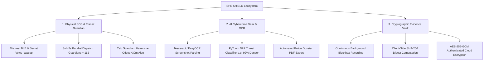
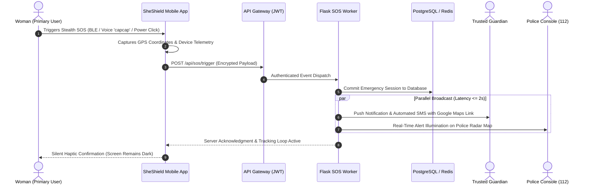

# 🛡️ SHE SHIELD — Cyber-Integrated Safety Platform for Women

[](https://flutter.dev)
[](https://dart.dev)
[](https://www.python.org/)
[](https://flask.palletsprojects.com/)
[](https://pytorch.org/)
[](https://www.postgresql.org/)
[](https://redis.io/)
[](https://www.docker.com/)
[](LICENSE)

> **A Proactive, Multi-Modal Emergency Dispatch, Transit Geofencing, and Cryptographic Forensic Ecosystem**  
> *Developed for WSSOA (IT644) · Autumn Semester 2026 · Dhirubhai Ambani University, Gandhinagar*

---

## 📌 Executive Summary

Modern personal safety applications suffer from three catastrophic design flaws:
1. **Single-Vector Focus:** They treat safety purely as a physical panic problem while ignoring digital gender-based violence (cyber harassment, doxxing, sextortion, and online blackmail).
2. **Panic Latency:** During acute physical attacks or stalking, victims enter a fight-or-flight state where fine motor skills degrade. Requiring a user to unlock a smartphone, navigate menus, and dial numbers alerts assailants and creates fatal delays.
3. **Evidence Destruction:** Threatening chats, extortion demands, and harassment screenshots are easily deleted by perpetrators or lost through disappearing messaging. Conventional screenshots lack cryptographic timestamps and hash proofs, leading to rejection in court under **Section 65B of the Indian Evidence Act**.

**SHE SHIELD** re-engineers personal defense into an integrated, proactive cyber-physical safety ecosystem. By uniting **multi-modal stealth triggers** ($\le 2$s dispatch), continuous **Cab & Walk Guardian geofencing** ($>30\text{m}$ route deviation alerts), **AI-driven cybercrime screenshot OCR scanning**, and a **tamper-proof SHA-256 / AES-256 Cryptographic Evidence Vault**, SheShield safeguards women across both the physical and digital realms.

---

## 🌟 Core Architectural Pillars



### 1. Physical Emergency SOS & Real-Time Transit Tracking
* **Multi-Modal Stealth Triggers:** Panic alerts can be dispatched via discreet Bluetooth Low Energy (BLE) smart pendants, an offline secret voice phrase (`"capcap"`), or a double/triple power button click—operating silently with zero screen illumination.
* **Sub-2-Second Emergency Fan-Out:** An emergency trigger instantly alerts linked family guardians via WebSockets, illuminates the nearest police terminal, and queues an SMS fallback.
* **Cab Guardian & Walk Guardian:** Continuously calculates vehicle trajectory against the planned routing polyline using the Haversine formula; flags unauthorized route detours ($>30\text{m}$) and alerts guardians before danger escalates.
* **Offline Telemetry & SMS Fallback:** Caches high-frequency GPS breadcrumbs locally in SQLite during network drops and dispatches carrier SMS containing a live Google Maps coordinate link.

### 2. AI-Powered Cybercrime Desk with OCR Screenshot Scanning
* **Automated Screenshot Parsing:** An OCR pipeline powered by Tesseract / EasyOCR extracts text, timestamps, phone numbers, and sender handles from uploaded chat screenshots.
* **PyTorch NLP Threat Assessment:** A fine-tuned transformer model categorizes digital abuse (blackmail, stalking, impersonation) and assigns an automated threat severity index (e.g. `92% Critical Risk`).
* **Instant Complaint Generation:** Auto-compiles verified screenshot metadata, extracted text, and victim statements into a formal police complaint dossier.

### 3. Tamper-Proof Cryptographic Evidence Vault
* **Continuous Blackbox Capture:** Automatic background audio and video recording during active transit sessions or emergency alerts.
* **Client-Side SHA-256 Hashing:** Unique digital fingerprints are calculated on the mobile device *before* data transmission, preventing any claim of evidence tampering.
* **AES-256-GCM Authenticated Encryption:** Vaulted assets are encrypted at rest and in transit.
* **Legal Admissibility:** Structured to satisfy the evidentiary threshold of **Section 65B of the Indian Evidence Act**, establishing an unbroken chain of custody for court proceedings.

---

## 🏛️ System Architecture

SHE SHIELD is designed as a decoupled, 4-tier Service-Oriented Architecture:

```
┌────────────────────────────────────────────────────────────────────────┐
│                      TIER 1: PRESENTATION LAYER                         │
│  Flutter Mobile App (Women Client · 60fps · BLE Hardware Bindings)      │
│  React.js Command Portal (Police Dispatch Radar · System Administration)│
└───────────────────────────────────┬────────────────────────────────────┘
                                    │ HTTPS / WSS / REST
┌───────────────────────────────────▼────────────────────────────────────┐
│                  TIER 2: API GATEWAY & SECURITY LAYER                  │
│  JWT Authentication · Role-Based Access Control (RBAC) · TLS 1.3        │
│  Redis-Backed Sliding-Window Rate Limiting · Request Triage Reverse-Proxy│
└───────────────────────────────────┬────────────────────────────────────┘
                                    │ Authenticated Microservice Calls
┌───────────────────────────────────▼────────────────────────────────────┐
│              TIER 3: CORE APPLICATION & AI / OCR ENGINES                │
│  Python Flask Microservices:                                           │
│    • Emergency SOS Parallel Broadcaster    • Cab Route Deviation Engine │
│    • Travel & Walk Tracker                • Cybercrime Intake Desk     │
│  AI Engine: PyTorch NLP Threat Classifier & OCR Screenshot Pipeline    │
└───────────────────────────────────┬────────────────────────────────────┘
                                    │ Read / Write / Hash Verifications
┌───────────────────────────────────▼────────────────────────────────────┐
│                    TIER 4: DATA & STORAGE LAYER                         │
│  PostgreSQL (ACID-compliant: Users, RBAC, SOS Sessions, Complaints)    │
│  Redis (Sub-ms live GPS telemetry streaming & session pub/sub cache)   │
│  Encrypted Cloud Storage (AES-256 media assets & SHA-256 hash ledger) │
└────────────────────────────────────────────────────────────────────────┘
```

---

## 👥 Stakeholders & Role-Based Access Control (RBAC)

SHE SHIELD enforces strict privilege boundaries using cryptographically signed JSON Web Tokens (JWT):

| Role Persona | Permissions & Scope | Key Capabilities |
| :--- | :--- | :--- |
| **Women / Primary User** | Own telemetry, personal contacts, own Evidence Locker | • Trigger stealth SOS ($\le 2$s)<br>• Activate Cab & Walk Guardian<br>• File cyber harassment reports<br>• Access personal Evidence Vault |
| **Trusted Guardian** | Scoped read-only access to linked user's active trips | • Receive live GPS waypoint streams<br>• Route deviation push alerts ($>30\text{m}$)<br>• Automated SMS fallback links<br>• Safe arrival confirmations |
| **Police / Responder** | Active emergency alerts within geographic sector | • Live emergency radar map<br>• Prioritized incident dispatch queue<br>• Victim medical/biometric profiles<br>• Court-admissible incident dossiers |
| **System Administrator** | Platform infrastructure & compliance | • Manage RBAC role assignments<br>• Configure unsafe zone polygons<br>• Inspect immutable audit logs<br>• Monitor AI models and server uptime |

---

## ⚡ Execution Flow: Emergency SOS Parallel Broadcast



---

## 📡 REST API Endpoint Contracts

| Method | Endpoint | Description | Auth Scope |
| :--- | :--- | :--- | :--- |
| `POST` | `/api/auth/register` | Registers a new user account with biometric / Aadhaar verify simulation | Public |
| `POST` | `/api/auth/login` | Authenticates user & issues short-lived 15-min JWT token | Public |
| `POST` | `/api/sos/trigger` | Dispatches emergency SOS alert with live GPS coordinates ($\le 2$s) | User |
| `POST` | `/api/travel/start` | Initializes Cab Guardian / Walk Guardian transit session with ETA | User |
| `POST` | `/api/travel/coordinate` | Ingests real-time waypoints & checks for route deviations ($>30\text{m}$) | User |
| `POST` | `/api/cybercrime/evidence` | Ingests screenshot proof, calculates client SHA-256 hash | User |
| `POST` | `/api/cybercrime/report` | Submits structured cybercrime report with threat narrative | User |
| `POST` | `/api/cybercrime/scan` | Runs OCR pipeline & PyTorch NLP threat model to calculate risk score | User |
| `GET` | `/api/admin/incidents` | Retrieves active emergency incidents within responder jurisdiction | Police / Admin |
| `PUT` | `/api/admin/complaints/{id}` | Updates complaint status, adds case resolution notes & court dossier | Police / Admin |

---

## 📂 Project Repository Structure

```
she-shield/
├── she_shield/                     # Flutter Mobile Application (Android / iOS)
│   ├── lib/
│   │   ├── main.dart               # App entrypoint & Provider state orchestration
│   │   ├── theme/
│   │   │   └── app_theme.dart      # Material 3 design system & glassmorphism
│   │   ├── services/
│   │   │   ├── database_service.dart   # Core local & remote state manager
│   │   │   ├── sos_service.dart        # 5-second countdown & trigger engine
│   │   │   ├── safety_map_service.dart # Real-time GPS breadcrumbs & waypoints
│   │   │   ├── ai_unsafe_zone.dart     # Heuristic nocturnal risk scoring
│   │   │   ├── admin_service.dart      # Admin command operations & zone control
│   │   │   └── pdf_report_service.dart # Court-ready incident report PDF export
│   │   └── screens/
│   │       ├── auth_screens.dart           # Multi-role login & registration
│   │       ├── dashboard_screen.dart       # Primary user safety hub
│   │       ├── sos_screens.dart            # Multi-modal SOS center
│   │       ├── travel_monitor_screen.dart  # Cab & Walk Guardian monitors
│   │       ├── wearable_pairing_screen.dart# BLE panic pendant manager
│   │       ├── cyber_screens.dart          # Cyber harassment desk & OCR scan
│   │       ├── evidence_vault_screens.dart # Cryptographic Evidence Locker
│   │       ├── guardian_dashboard_screen.dart # Guardian live radar
│   │       ├── responder_dashboard_screen.dart # Police dispatch console
│   │       └── admin_command_center_screen.dart # System admin console
│   ├── android/                    # Native Android project configuration
│   └── pubspec.yaml                # Flutter dependencies & assets
│
├── backend/                        # Python Flask Microservices & AI Engines
│   ├── app.py                      # Flask RESTful API & emergency dispatcher
│   └── requirements.txt            # Python dependencies (Torch, Transformers, OpenCV)
│
├── firebase/                       # Cloud Firestore security & configuration
│   ├── firestore.rules             # RBAC database security rules
│   └── firebase.json               # Firebase emulator & hosting settings
│
├── extracted_assets/               # High-resolution architectural diagrams & logos
│   ├── three_tier_architecture.jpg # 3-Tier System Architecture Diagram
│   ├── use_case_diagram.jpg        # Unified System Use Case Diagram
│   ├── sos_flow_diagram.jpg        # Emergency SOS Parallel Flow Diagram
│   ├── minimal_pipelines.png       # Minimal Data Pipelines Diagram
│   └── she_shield_logo.jpg         # SheShield vector emblem
│
├── SheShield_Minimalist_Presentation.pptx # 13-slide academic slide deck
├── SheShield_Minimalist_Design_Document.docx # Complete design specification document
└── README.md                       # Comprehensive platform documentation
```

---

## 🛠️ Technology Stack & Justification

| Technology | Role | Justification in SheShield |
| :--- | :--- | :--- |
| **Flutter 3.x (Dart)** | Mobile Client | Single codebase compiling natively to Android and iOS with 60fps performance and direct platform channels to Bluetooth LE hardware. |
| **React.js + Tailwind** | Command Web Portal | High-density interactive dashboard for emergency police dispatchers with real-time WebSocket state management. |
| **Python Flask** | Backend Microservices | Lightweight, asynchronous WSGI framework offering seamless native integration with PyTorch and OpenCV AI pipelines. |
| **PostgreSQL** | Relational Database | Strict ACID compliance for user accounts, RBAC permissions, complaint dossiers, and immutable audit trails. |
| **Redis** | In-Memory Streaming | Sub-millisecond pub/sub latency for distributing real-time GPS coordinates and managing sliding-window rate limiters. |
| **PyTorch & Transformers** | AI Threat Models | Evaluates harassment message toxicity and extortion severity in under 3 seconds. |
| **Tesseract / EasyOCR** | OCR Vision Engine | Parses blackmail screenshots, extracting sender identities, message text, and timestamps directly on upload. |
| **SHA-256 + AES-256-GCM** | Cryptographic Vault | Guaranteed bit-for-bit forensic integrity meeting Indian Evidence Act Section 65B legal standards. |

---

## 🚀 Getting Started & Installation

### 1. Prerequisites
* **Flutter SDK:** `>= 3.10.0`
* **Dart SDK:** `>= 3.0.0`
* **Python:** `3.9+`
* **PostgreSQL:** `15+`
* **Redis:** `7.x+`
* **Git**

### 2. Clone the Repository
```bash
git clone https://github.com/priyashah-05/she-shield.git
cd she-shield
```

### 3. Backend Setup
```bash
# Navigate to backend directory
cd backend

# Create and activate virtual environment
python3 -m venv venv
source venv/bin/activate  # On Windows: venv\Scripts\activate

# Install dependencies
pip install -r requirements.txt

# Run the Flask API microservice
python app.py
# Backend runs on http://localhost:5000
```

### 4. Mobile App Setup (Flutter)
```bash
# Navigate to mobile client directory
cd ../she_shield

# Fetch dependencies
flutter pub get

# Run on connected Android / iOS device or emulator
flutter run
```

---

## 🔒 Security & Privacy Guarantees

* **Zero-Trust RBAC:** Every API endpoint verifies cryptographically signed JWT tokens with a strict 15-minute expiration window.
* **30-Day Location Data Minimization:** Non-emergency transit breadcrumbs are automatically purged after 30 days in strict compliance with the **Digital Personal Data Protection (DPDP) Act** and **GDPR**.
* **Anti-DDoS Sliding Window:** Redis token-bucket rate limiters throttle volumetric flooding while giving absolute priority to `/api/sos/*` packets.
* **Tamper-Evident Forensic Audit:** Client-side SHA-256 digests prevent retroactive modification of recorded evidence.

---

## 👥 Engineering Team & Academic Credentials

**School of Technology & Computer Science  
Dhirubhai Ambani University, Gandhinagar**  
*Course: Web Services and Service-Oriented Architecture (WSSOA IT644) · Autumn Semester 2026*

| Student Name | Student ID | Specific Project Engineering Role |
| :--- | :--- | :--- |
| **Jainam Shah** | `202512012` | **Backend APIs** (Flask REST Microservices, Dispatches & Hooks) |
| **Maahir Shah** | `202512022` | **Database Architecture** (PostgreSQL Schema, Redis Streams & Cache) |
| **Hitarth Shah** | `202512042` | **AI Threat Models** (PyTorch NLP Classifier & Threat Scoring) |
| **Jay Shah** | `202512059` | **DevOps & Integration** (Docker, CI/CD, Gateway Telemetry & Hooks) |
| **Nirmal Patel** | `202512102` | **Authentication & RBAC** (JWT Security Tokens & Access Control) |
| **Priya Shah** | `202512105` | **Navigation & User Flow** (Routing, State Management & Mobile UI) |
| **Jenil Shah** | `202512110` | **Cybersecurity** (Evidence Vault, SHA-256 Hashing & AES Encryption) |
| **Krisha Doshi** | `202512112` | **Mobile UI Engineering** (Flutter 3.x, Material 3 & Responsive Screens) |

---

## 📜 License & Disclaimers

This project is licensed under the **MIT License** — see the [LICENSE](LICENSE) file for details.  
*Disclaimer: SHE SHIELD is an academic engineering platform designed to demonstrate modern service-oriented architecture, emergency telemetry, and cryptographic evidence preservation. Integration hooks for civic frameworks (ERSS-112, CCTNS, CERT-In) are implemented in architecture mode for testing and evaluation.*
